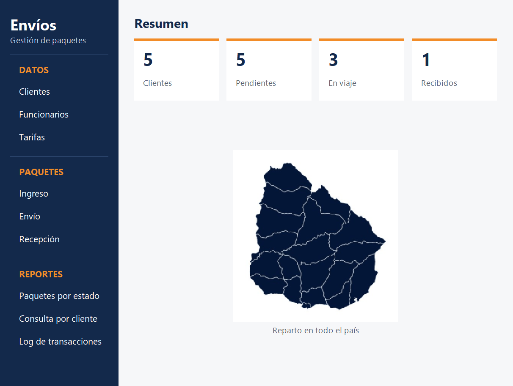
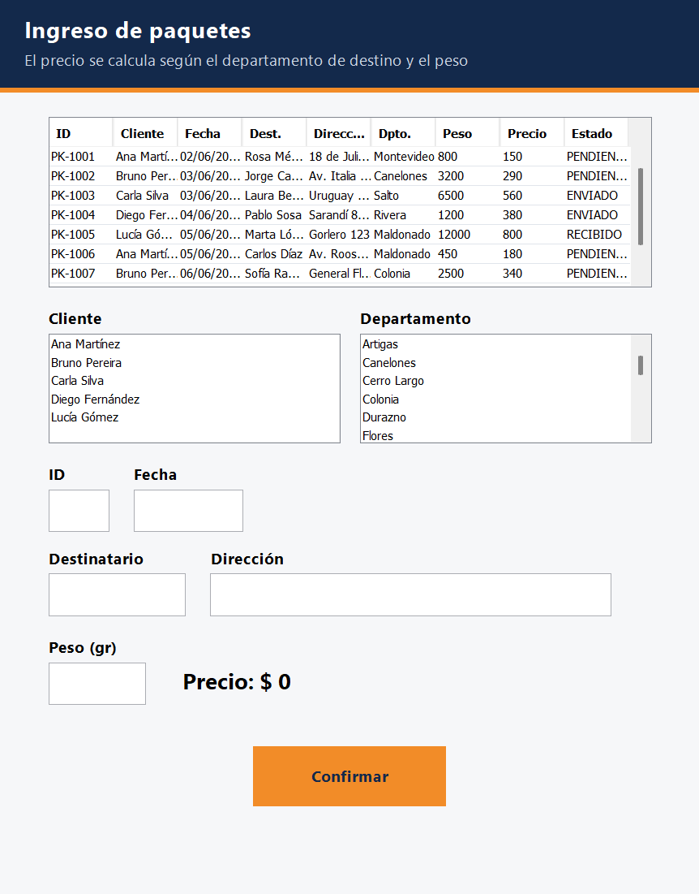
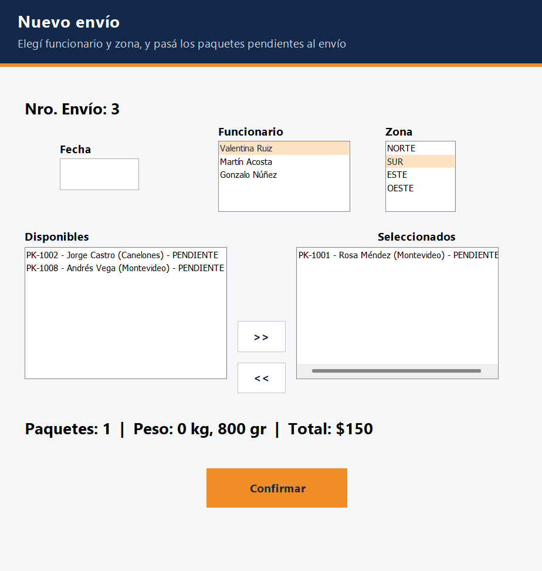
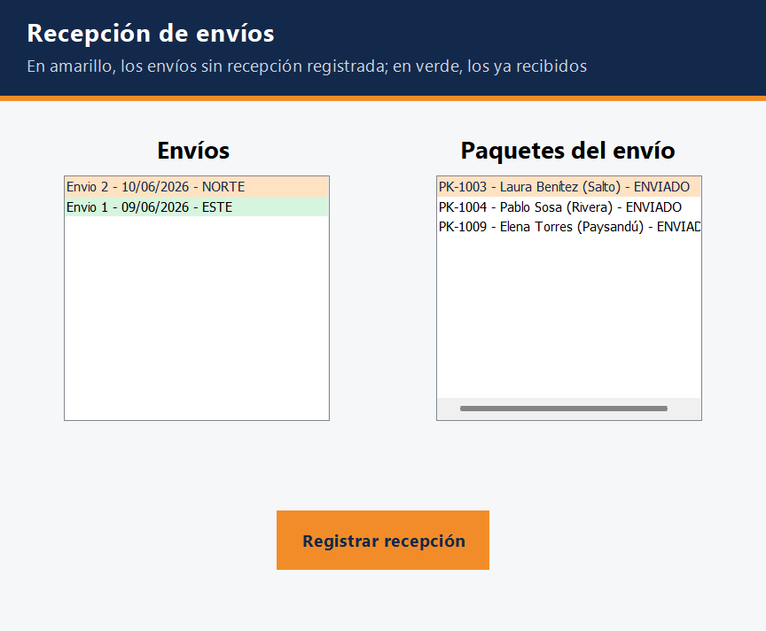
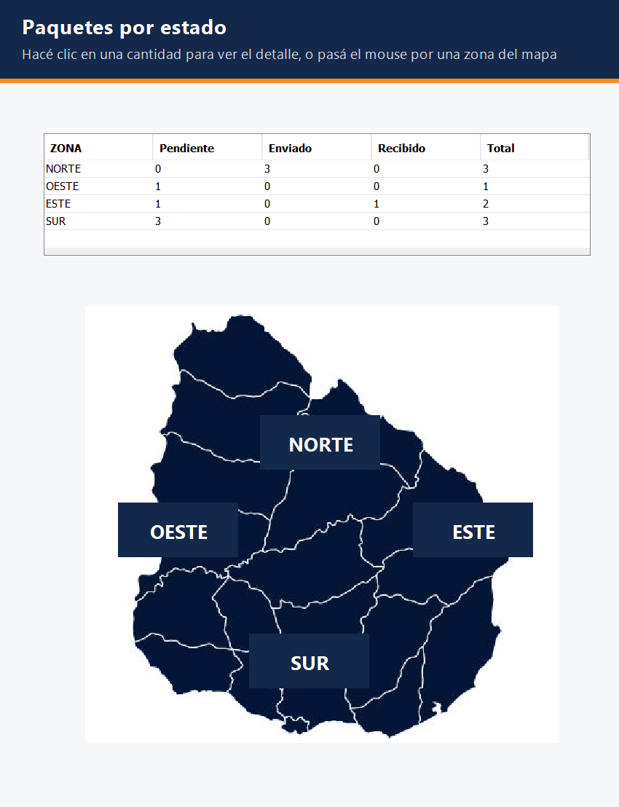
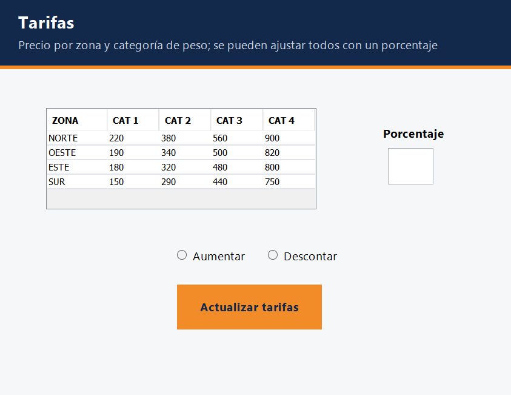
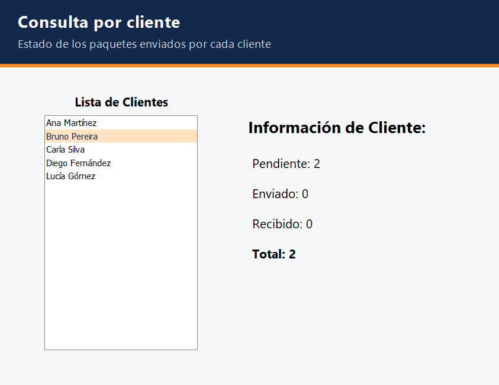
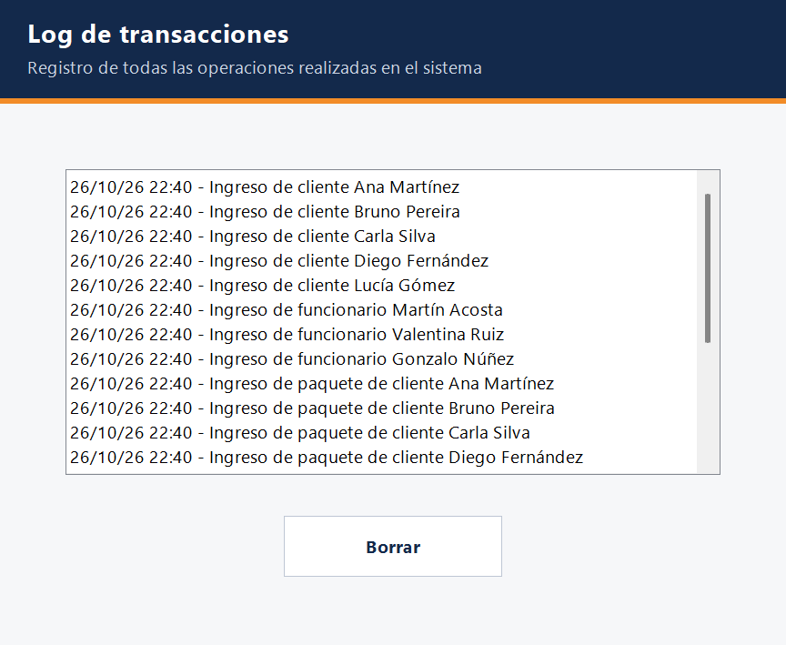
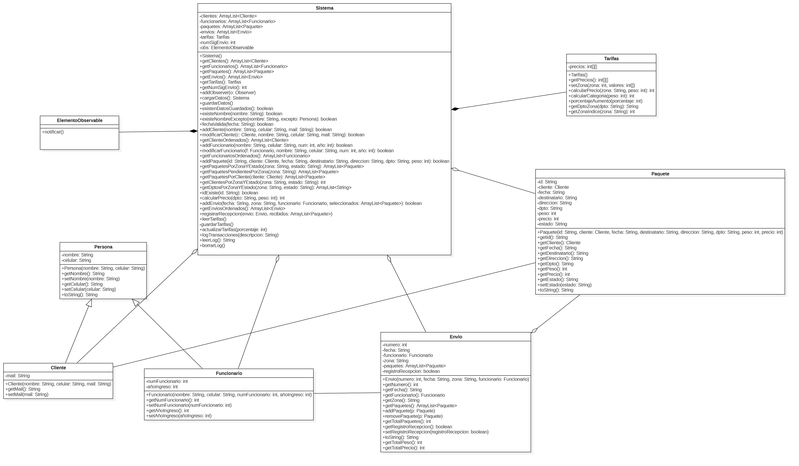

# Sistema de gestión de envíos

Aplicación de escritorio en Java para una empresa que distribuye paquetes en todo Uruguay: clientes que mandan
paquetes, funcionarios que los organizan en envíos por zona y el seguimiento de cada paquete hasta que se recibe.

> Proyecto académico de la Licenciatura en Sistemas, Universidad ORT Uruguay (2026).



## Qué hace

- **Clientes y funcionarios:** alta y modificación. Los nombres son únicos en todo el sistema. Los clientes se
  listan por nombre y los funcionarios por año de ingreso, del más reciente al más antiguo.
- **Tarifas:** el precio depende de la zona de destino (Norte, Oeste, Este, Sur) y de la categoría de peso. Se
  leen de `Tarifas.txt` al iniciar y se pueden subir o bajar todas con un porcentaje; el archivo se actualiza.
- **Ingreso de paquetes:** identificador único, cliente, fecha, destinatario, dirección, departamento y peso. El
  precio se calcula y se muestra antes de confirmar. El paquete queda *pendiente*.
- **Envíos:** un funcionario arma un envío para una zona con paquetes pendientes de esa zona, que pasan a *enviado*.
- **Recepción:** se marcan los paquetes que llegaron (*recibido*); los que no, vuelven a *pendiente*.
- **Reportes:**
  - *Paquetes por estado*: cantidad por zona y estado, con un mapa; al hacer clic en una cantidad se ven los
    clientes y departamentos involucrados.
  - *Consulta por cliente*: cuántos paquetes de un cliente están pendientes, enviados o recibidos.
  - *Log de transacciones*: cada operación queda registrada con fecha y hora en `Transacciones.log`.
- **Persistencia:** al cerrar, todo se guarda en el archivo `datos` (serialización de Java). Al abrir se elige
  si continuar con lo guardado o empezar de cero.

## Capturas

| | |
|---|---|
|  |  |
|  |  |
|  |  |
|  |  |

## Cómo está hecho

- **Java** con **Swing**. Las ventanas se armaron con el diseñador de NetBeans (cada una tiene su `.form`).
- Interfaz con el aspecto del sistema operativo y una identidad propia (azul noche y naranja): cada ventana tiene
  un encabezado y su acción principal destacada, y el menú principal muestra todas las opciones en una barra
  lateral junto a un resumen que se actualiza solo (`interfaz/Estilo` y `VentanaMenu`).
- Separación en paquetes:
  - `dominio`: las clases del negocio (`Sistema`, `Persona`, `Cliente`, `Funcionario`, `Paquete`, `Envio`,
    `Tarifas`), sin código de interfaz.
  - `interfaz`: las ventanas, que solo usan el dominio.
  - `inicio`: el punto de entrada (`Main`).
- **Patrón Observer:** `Sistema` avisa cada cambio y las ventanas abiertas se actualizan solas (por ejemplo, un
  cliente nuevo aparece en todas las listas sin cerrar nada).
- Archivos: lectura y escritura de `Tarifas.txt`, el log de transacciones y la serialización de los datos.
- Sin librerías externas. Proyecto de **NetBeans** (Ant).



## Cómo ejecutarlo

Requisitos: JDK 24 o superior.

### Con NetBeans

Abrir la carpeta del proyecto (*File → Open Project*) y ejecutarlo con *Run* (F6).

### Desde la terminal

Con [Apache Ant](https://ant.apache.org/) (viene con NetBeans), desde la carpeta del proyecto:

```powershell
ant jar
java -jar dist/SistemaEnvios.jar
```

Hay que ejecutarlo desde la carpeta del proyecto: ahí están `Tarifas.txt` y ahí se guardan `datos` y
`Transacciones.log`.
